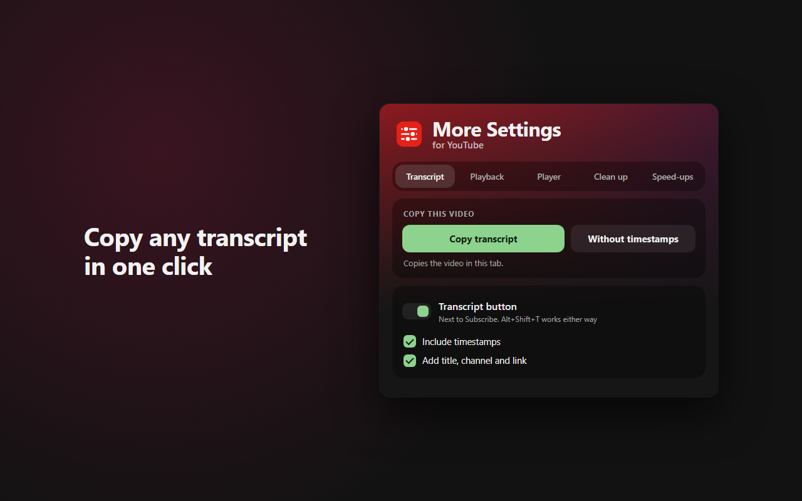
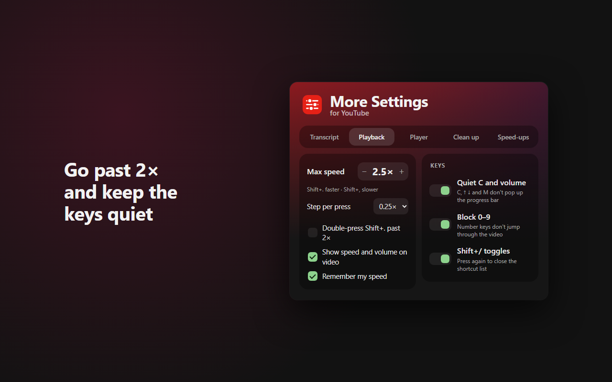
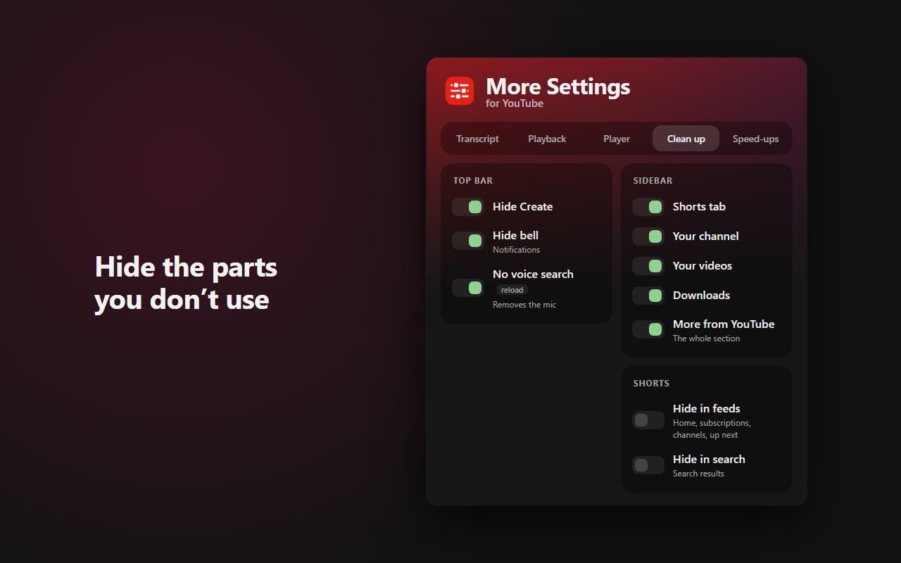

# More Settings for YouTube

A Firefox add-on that adds the settings YouTube doesn't give you: one-click transcript copy, speeds past 2×, keyboard fixes, a bigger theater mode and less clutter.

**[Install from Firefox Add-ons](https://addons.mozilla.org/firefox/addon/more-settings-for-youtube/)** (Firefox 128 or later)

## Features

Every feature is a switch in the toolbar popup (titled "YouTube Settings"). Turn on only what you want.

- **Copy any transcript**: a Transcript button next to Subscribe copies it with timestamps. Shift-click copies it without. You can also copy from the popup or with Alt+Shift+T.
- **Speed past 2×**, up to your own maximum (default 2.5×, up to 16×), with an on-screen speed label. Speed is remembered between videos.
- **Keyboard fixes**: number keys no longer jump through the video, V no longer opens the suggested videos grid, and C, arrow keys and M no longer pop up the progress bar.
- **Bigger theater mode** that fills the browser window under YouTube's header.
- **Hide clutter**: Shorts, end-of-video suggestions, the channel logo on the video, the Create button, the notifications bell, voice search and sidebar items (each its own switch).
- **Lighter YouTube**: no see-through blur, no animations and no ambient glow behind the video.
- **Calm fullscreen**: no scrolling, no "more videos" grid and no like/share buttons.

## Keyboard shortcuts

| Keys | What it does |
|---|---|
| Alt+Shift+T | Copy the transcript (change it in about:addons > gear menu > Manage Extension Shortcuts) |
| Shift+. / Shift+, | Speed up / slow down, past 2× |
| Shift+/ | Opens YouTube's shortcut list, and now also closes it |

## Privacy

- Collects no data. Settings are stored in Firefox on your own computer.
- Only runs on www.youtube.com.
- The only network requests go to youtube.com, when you copy a transcript, to fetch that video's transcript.

## Report a problem

Open an issue on the [Issues page](https://github.com/TimWJT/more-settings-for-youtube/issues). Say what you expected, what happened, and your Firefox version.

## For developers

- Run from source: open `about:debugging#/runtime/this-firefox`, click **Load Temporary Add-on…** and pick `manifest.json`. Reload any open YouTube tabs.
- Build the upload zip: `npx web-ext build --overwrite-dest --ignore-files "*.md" screenshots`
- Files: `page.js` runs in YouTube's page (keys, speed, theater, transcript, button). `background.js` handles Alt+Shift+T. `content.js` bridges settings storage, clipboard and the popup. `settings.js` holds the defaults (`page.js` has its own copy; keep them in sync).
- The transcript is fetched three ways, falling back in order: YouTube's transcript API, the player's caption file, then YouTube's own transcript panel opened off-screen. The browser console (F12) logs which one worked.
- Design notes are in [NOTES.md](NOTES.md) and test steps in [TESTING.md](TESTING.md).

## Licence

All Rights Reserved. The source is public so it can be read and reviewed. See [LICENSE](LICENSE).

Not affiliated with YouTube or Google.
